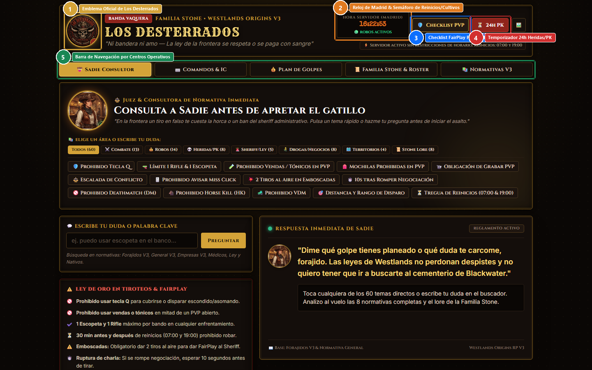
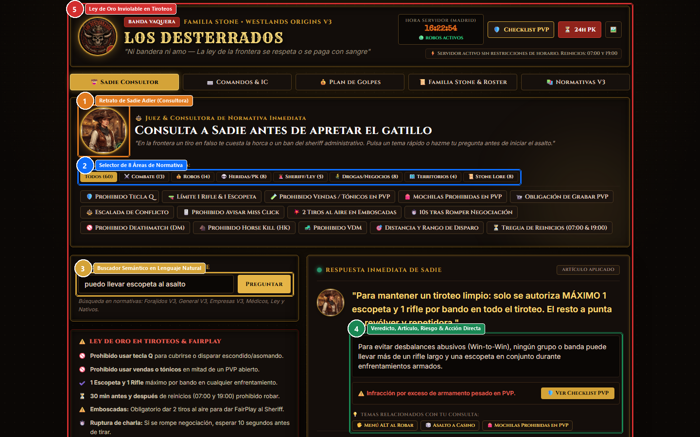
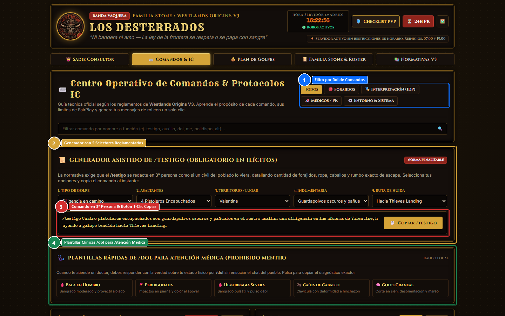
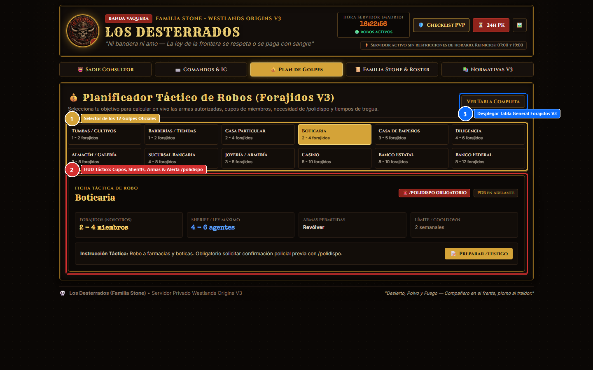
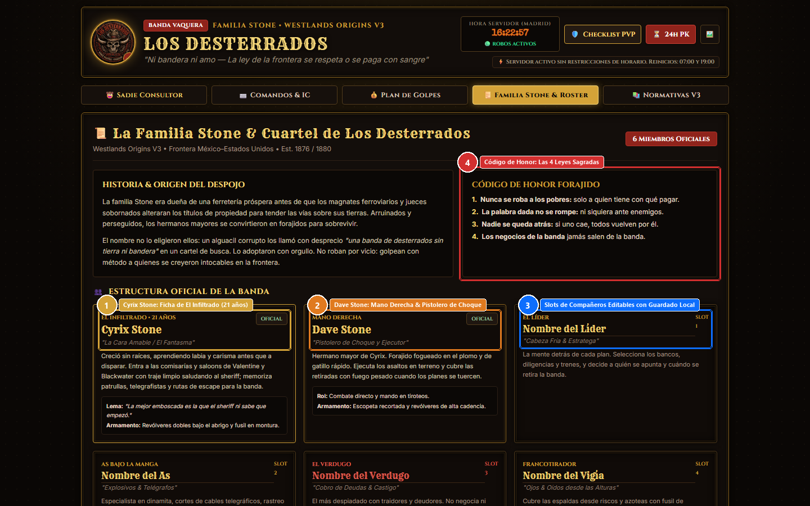
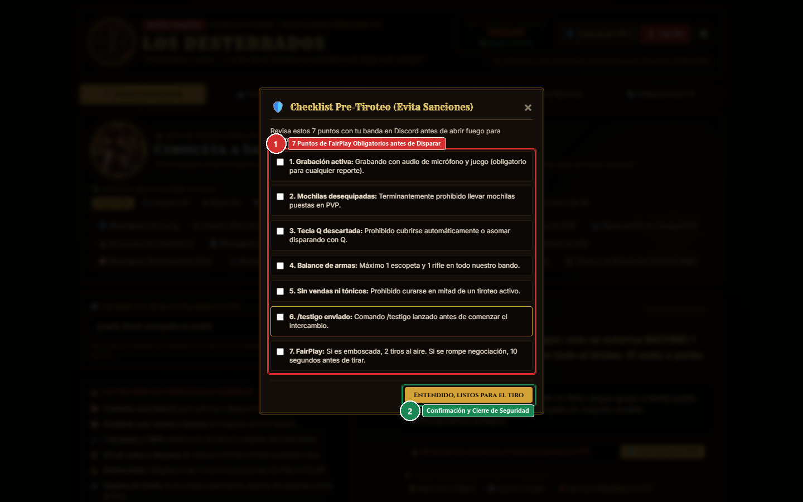

# 🤠 MANUAL DE USUARIO Y OPERACIÓN TÁCTICA
## Cuartel de Los Desterrados | Familia Stone • Westlands Origins V3
**Autor y Consultor:** René Puig (Cyrix Stone)  
**Plataforma:** Aplicación Web de Soporte Táctico (GitHub Pages / SPA)  
**Versión de Rol:** Westlands Origins V3 • Servidor Privado RDR2 RP  
**Fecha:** Octubre de 2026  

---

## 1. Introducción y Propósito Operativo

El **Cuartel de Los Desterrados** es la plataforma táctica y centro de consulta inmediata desarrollada para los miembros de la banda forajida y la **Familia Stone** dentro del servidor privado de rol **Westlands Origins V3**.

### Problemática Resuelta
En un servidor de rol estricto de Red Dead Redemption 2, las infracciones administrativas se pagan caro: desde advertencias y pérdida de botines hasta penas de cárcel en Sisika o baneos permanentes. Las causas más comunes de sanción suelen ser:
1. **Descuido de horarios de reinicio:** Cometer delitos durante la ventana de 30 minutos antes o después de las 07:00 y las 19:00.
2. **Infracciones de combate:** Cubrirse con la tecla Q, exceder el límite de 1 rifle y 1 escopeta por bando, portar mochilas en tiroteos o usar vendas en combate.
3. **Mala praxis en comandos:** Olvidar lanzar el `/testigo` antes del primer disparo o mentir por `/dol` sobre impactos de bala a los médicos.
4. **Venganza prematura (RK):** Entrar a combate antes de cumplir las 24 horas reales de convalecencia tras caer en PK.

Esta herramienta centraliza todas las normativas, automatiza la redacción de comandos reglamentarios con un solo clic y ofrece un consultor de respuesta inmediata para que ningún forajido cometa errores durante las partidas.

---

## 2. Pantalla Principal, Identidad y Monitor de Servidor

La cabecera de la aplicación está permanentemente visible y contiene el sistema de sincronización horaria y monitoreo del servidor:

### Marcas de Interacción (Figura 1)
* **① Emblema Oficial de Los Desterrados:** Muestra el escudo oficial de la banda (Est. 1876). Al hacer clic sobre el avatar o la insignia de la cámara, permite cargar una imagen personalizada desde la PC o celular, la cual se guarda automáticamente en el navegador (`localStorage`) sin borrarse.
* **② Reloj Oficial de Madrid & Semáforo de Servidor:** Sincronizado en tiempo real con la zona horaria peninsular española (`Europe/Madrid`). Integra dos detectores automáticos:
  * **Alerta de Reinicios Diarios (07:00 y 19:00):** Si el reloj entra en la franja de 30 minutos previos o posteriores (06:30 a 07:30 y 18:30 a 19:30), el badge cambia a `🚨 TREGUA DE REINICIO` y despliega un banner rojo indicando la prohibición estricta de iniciar actos delictivos. Fuera de esa franja muestra `🟢 ROBOS ACTIVOS`.
  * **Horario de Cultivos:** Si el reloj marca entre las 20:00 y las 02:00, se ilumina el indicador dorado `🌾 CULTIVOS ACTIVOS`, confirmando que el robo a huertos está habilitado.
* **③ Botón 'Checklist PVP':** Abre el diálogo emergente con las 7 verificaciones obligatorias de combate antes de abrir fuego.
* **④ Botón '24h PK':** Despliega el temporizador de convalecencia con cuenta regresiva en vivo persistente para controlar el cooldown de Revenge Kill (RK).
* **⑤ Barra de Navegación por Centros Operativos:** Permite alternar de inmediato entre las 5 vistas de la plataforma sin recargar la página.

---

## 3. Consultor Sadie Adler (Búsqueda Semántica de Normativas)

Ubicada en el salón principal, **Sadie Adler** actúa como la consultora de normativa inmediata de la banda:

### Marcas de Interacción (Figura 2)
* **① Retrato de Sadie:** Representa la voz de la consultora. Se puede personalizar su retrato haciendo clic directamente sobre el marco circular.
* **② Selector de 8 Áreas Normativas:** Filtra los 60 temas oficiales indexados en categorías rápidas: *⚔️ Combate (13)*, *💰 Robos (14)*, *💀 Heridas/PK (8)*, *🚨 Sheriff/Ley (5)*, *🌾 Drogas/Negocios (8)*, *🗺️ Territorios (4)* y *📜 Stone Lore (8)*.
* **③ Buscador Semántico:** Permite escribir cualquier duda en lenguaje natural (ej. *"¿puedo llevar escopeta al asalto?"*, *"¿qué pasa si huyo a México?"*, *"¿puedo curarme con vendas?"*). El algoritmo normaliza acentos, descarta palabras irrelevantes y localiza la regla exacta por scoring de relevancia.
* **④ Panel de Resolución Enriquecido:** Muestra la respuesta en cuatro niveles:
  * *Veredicto de Sadie:* Consejo táctico directo con la personalidad de la forajida.
  * *Artículo Oficial Aplicado:* La cita textual y límites numéricos de los reglamentos V3.
  * *Badge de Riesgo / Sanción:* La infracción administrativa exacta que imputa el STAFF si se vulnera la norma.
  * *Botón de Acción Directa:* Enlaces interactivos como *"Ver Checklist PVP"*, *"Abrir Plan de Golpes"* o *"Iniciar Cooldown"*.
  * *Temas Relacionados:* Botones sugeridos automáticamente con temas afines a tu consulta.
* **⑤ Ley de Oro en Tiroteos:** Cuadro resumen permanente con las 6 reglas inviolables de combate (no tecla Q, no vendas en PVP, máx 1 rifle y 1 escopeta por bando, 30 min de reinicio y 2 disparos al aire en emboscadas).

---

## 4. Centro Operativo de Comandos & Generador Asistido de /testigo

Ubicado en la pestaña `⌨️ Comandos & IC`, este módulo profesionaliza la comunicación dentro del servidor:

### Marcas de Interacción (Figura 3)
* **① Filtros de Comandos:** Permite alternar entre *Todos*, *🔴 Forajidos*, *🎭 Interpretación (IDP)*, *🚑 Médicos/PK* y *⚙️ Entorno/Sistema*.
* **② Generador Asistido de /testigo:** Herramienta interactiva con 5 selectores para configurar el aviso que exige la normativa antes de cualquier delito:
  1. *Tipo de Golpe:* Diligencia, Tienda, Casa particular, Boticaria, Empeños, Sucursal, Armería, Venta de droga fallida, etc.
  2. *Asaltantes:* De 1 forajido solitario a 6 jinetes.
  3. *Lugar:* Valentine, Rhodes, Blackwater, Strawberry, Saint Denis, Armadillo, Tumbleweed, Flatneck, etc.
  4. *Indumentaria:* Guardapolvos oscuros y pañuelos, ropa de cuero, máscaras de arpillera, ponchos, etc.
  5. *Ruta de Escape:* Hacia Thieves Landing, Tall Trees, Grizzlies, frontera mexicana, etc.
* **③ Caja de Salida y Copiado Inmediato:** Presenta el texto generado en 3ª persona cumpliendo las exigencias de la policía y el STAFF. El botón **'📋 Copiar /testigo'** lo transfiere al portapapeles y despliega una notificación toast de confirmación.
* **④ Plantillas Clínicas Rápidas de /dol:** 5 botones para responder al doctor con la verdad sobre heridas físicas sin ensuciar el chat del pueblo:
  * *Bala en Hombro:* Orificio de bala con sangrado moderado y proyectil alojado.
  * *Perdigonada:* Múltiples impactos superficiales de perdigón en pierna.
  * *Hemorragia Severa:* Herida punzante con sangrado pulsátil continuo.
  * *Caída de Caballo:* Dolor agudo en clavícula con hinchazón y deformidad.
  * *Golpe Craneal:* Corte en sien con mareo y desorientación momentánea.
* **⑤ Catálogo Detallado de Comandos:** Tarjetas individuales con sintaxis, reglas de uso, errores prohibidos y botón de copiado de ejemplos para `/me`, `/do`, `/mel`, `/dol`, `/auxilio`, Menú ALT, `/polidispo`, `/desembarco` y `/mp`.

---

## 5. Planificador Táctico de Robos (Calculadora de Asaltos)

En la pestaña `💰 Plan de Golpes`, se encuentra el asistente de asaltos basado en la tabla oficial de Forajidos V3:

### Marcas de Interacción (Figura 4)
* **① Selector en Cuadrícula de Golpes:** Permite seleccionar cualquiera de los 12 tipos de robo reglamentarios: Tumbas, Tiendas, Casa Particular, Boticaria, Casa de Empeños, Diligencia, Almacén, Sucursal, Joyería/Armería, Casino, Banco Estatal y Banco Federal.
* **② HUD Táctico Interactivo:** Al pulsar sobre un golpe, el panel calcula y muestra:
  * *Rango Requerido:* Si es accesible para todos, requiere Proyecto de Banda (PDB) o Niveles 1, 2 o 3.
  * *Cupos:* Número permitido de forajidos asaltantes vs. Sheriffs máximos que pueden acudir.
  * *Armas Autorizadas:* Revólver obligatorio vs. Armas a elección (respetando máx 1 rifle y 1 escopeta).
  * *Frecuencia / Cooldown:* Límite semanal o diario por organización.
  * *Alerta /polidispo:* Insignia en rojo parpadeante si es obligatorio pedir confirmación policial antes de ingresar.
* **③ Botón 'Preparar /testigo':** Vincula el HUD directamente con el generador de comandos, autocompletando el tipo de delito y llevándote a la pestaña de comandos con un clic.
* **④ Botón 'Ver Tabla Completa':** Abre el modal con la tabla comparativa oficial completa.

---

## 6. Cuartel de la Familia Stone & Roster de la Banda

En la pestaña `📜 Familia Stone & Roster`, se gestiona el trasfondo y los integrantes oficiales de la organización:

### Marcas de Interacción (Figura 5)
* **① Ficha de Cyrix Stone (21 años):** Detalla la historia de *El Infiltrado / La Cara Amable / El Fantasma*, formado en registros aduanales y telégrafos, su fachada limpia en Valentine y su equipamiento encubierto bajo el abrigo.
* **② Ficha de Dave Stone:** Historia del hermano mayor, pistolero de choque y ejecutor directo en tiroteos.
* **③ Slots de Banda Personalizables:** 4 espacios para los compañeros de la banda (El Líder, El As bajo la Manga, El Verdugo y El Vigía). Los nombres escritos se guardan automáticamente en la memoria del navegador (`localStorage`) para que cada jugador configure su cuadrilla.
* **④ Código de Honor de Los Desterrados:** Las 4 leyes sagradas de la banda (no robar a pobres, palabra sagrada, nadie atrás, negocios internos cerrados).

---

## 7. Herramientas Auxiliares y Modales de Seguridad

La plataforma incluye herramientas de apoyo rápido accesibles desde la cabecera:

### Marcas de Interacción (Figura 6)
* **① Checklist Pre-Tiroteo FairPlay:** Diálogo modal con 7 casillas interactivas que el líder o la banda deben repasar en Discord antes del primer tiro:
  1. *Grabación activa:* Grabador con micro y audio del juego encendido.
  2. *Mochilas fuera:* Desequipadas antes del combate.
  3. *Tecla Q descartada:* Prohibido cubrirse automáticamente.
  4. *Balance de armas:* Máximo 1 escopeta y 1 rifle en todo el grupo.
  5. *Sin vendas ni tónicos:* No curarse en mitad de un PVP abierto.
  6. */testigo enviado:* Comando lanzado antes de iniciar el intercambio.
  7. *FairPlay de aviso:* 2 tiros al aire en emboscada o 10s tras romper negociación.
* **② Botón de Confirmación:** Cierra el checklist tras verificar que todo el equipo cumple las normas.
* **Temporizador 24h Heridas/PK:** Permite pulsar *"Iniciar 24h Cooldown"* para arrancar un cronómetro con persistencia. Si recargas la página o apagas la PC, el tiempo sigue descontándose correctamente hasta llegar a `00:00:00`.
* **Gestor de Fotos:** Diálogo para reemplazar el escudo de Los Desterrados o el retrato de Sadie por archivos locales.

---

## 8. Preguntas Frecuentes y Buenas Prácticas (FAQ)

### ¿Qué hago si tengo dudas en mitad de una partida?
1. Abre la web en tu celular o en tu segundo monitor.
2. Escribe una palabra clave en el buscador de Sadie (ej. *rehenes*, *boticaria*, *vendas*, *escopeta*).
3. Revisa la insignia de riesgo y sigue la instrucción reglamentaria al instante.

### ¿Cómo aseguro que el /testigo esté bien enviado?
Entra a la pestaña `Comandos & IC`, selecciona tu golpe y tu pueblo, pulsa **'Copiar /testigo'**, abre la consola de chat en RedM con la tecla `T` y pega con `Ctrl + V`.

### ¿Por qué no debemos avisar "miss click" por /mp?
La normativa General V3 prohíbe expresamente romper la inmersión por errores de teclado. Si accidentalmente golpeas a alguien o disparas, interpreta el susto o la disculpa dentro del personaje (`IC`).

---

**Cuartel de Los Desterrados • Familia Stone**  
*Desierto, Polvo y Fuego — Compañero en el frente, plomo al traidor.*
